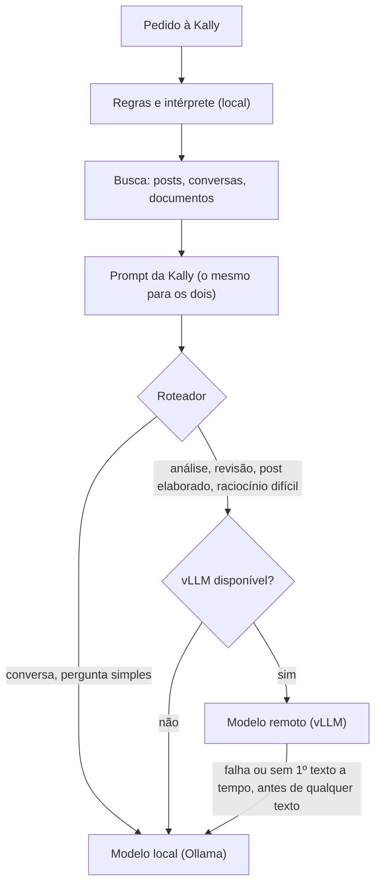

# Kally híbrida: modelo local + modelo remoto (vLLM)

Estado: implementada e testada com um vLLM falso e com um modelo real atrás da API OpenAI do
Ollama. **Ainda não foi testada com o Qwen 32B no Vast.ai** (a instância não estava configurada
quando o código foi escrito). Desligada por padrão: sem `KALLY_REMOTE_ENABLED="1"`, a Kally
funciona exatamente como antes.

## Arquitetura anterior

- Uma rota gera as respostas do app e do site: `src/app/api/mobile/env/[env]/kally/route.ts`.
- Pipeline (`KALLY_PIPELINE`): regras (`detectIntent`) e, quando elas não bastam, o intérprete
  (`src/server/kally/pipeline.ts`) classificam o pedido em competência (estudo, post, análise),
  modo e profundidade; o executor responde.
- Executor e intérprete: o mesmo modelo local (`KALLY_EXECUTOR_MODEL`, padrão
  `qwen3:4b-instruct-2507-q4_K_M`), pelo Ollama, com o gerenciador central de modelos
  (`src/server/ai/model-manager.ts`: um modelo de texto carregado por vez).
- RAG: busca de posts e conversas (`findRelevantPosts`) e de documentos (`searchDocuments`), com
  embeddings `qwen3-embedding:0.6b` na CPU. A busca é feita antes e fora da inferência; o prompt
  montado (`buildPrompt` / `buildCompetencePrompt`) já leva os trechos recuperados.
- Camada de IA: `src/server/ai.ts` (Ollama `/api/chat` ou, com `AI_PROVIDER=openai`, qualquer
  `/v1/chat/completions`, mas global, um provedor para tudo).

## Arquitetura nova

O que mudou, em ordem dos commits:

1. `think: false` para modelos híbridos (`KALLY_NO_THINK_MODELS`): o `qwen3:8b` raciocina por
   padrão e a 1ª palavra levava 30 a 52 s no pipeline.
2. `src/server/ai.ts`: cada chamada escolhe o destino (`target: "local" | "remote"`) e pode ser
   cancelada (`signal`). O caminho remoto reaproveita o modo OpenAI, sem o gerenciador de modelos
   (a GPU é outra), com métricas do bloco `usage`, o raciocínio `<think>` fora do texto e erro
   quando o stream termina sem `finish_reason`/`[DONE]` (conexão caída no meio não vira resposta
   "completa").
3. `src/server/ai/remote.ts`: configuração, saúde (`GET /v1/models`, confere se o modelo
   configurado é o servido e lê o `max_model_len`), estados, cache curto e vagas simultâneas.
4. `src/server/kally/router.ts`: decide local ou remoto com os sinais que a rota já tem. Nenhum
   modelo extra roda para decidir.
5. Rota da Kally: roteamento, fallback, cancelamento quando a pessoa sai, `backend` e motivo no log
   de desempenho (`logs/kally-perf.jsonl`), sem conteúdo do pedido.
6. `src/server/ai/gpu.ts` e `src/app/api/mobile/kally/gpu/route.ts`: GPU sob demanda no Vast.ai.

## Configuração (.env do servidor; nada disso vai para o app)

| Variável | Padrão | Para quê |
|---|---|---|
| `KALLY_EXECUTOR_MODEL` | `qwen3:4b-instruct-2507-q4_K_M` | modelo local (já existia; é o "KALLY_LOCAL_MODEL") |
| `KALLY_GPU_LAYERS` | — | camadas na placa por modelo; para o 8B IQ4_XS, `qwen3-8b-iq4xs=30` |
| `KALLY_NO_THINK_MODELS` | — | modelos que recebem `think: false` (ex.: `qwen3-8b-iq4xs,qwen3:8b`) |
| `KALLY_REMOTE_ENABLED` | desligado | `"1"` liga o modelo remoto |
| `KALLY_VLLM_BASE_URL` | — | endereço do vLLM (`http://IP:PORTA`, com ou sem `/v1`) |
| `KALLY_VLLM_API_KEY` | — | a chave do `--api-key` do vLLM |
| `KALLY_REMOTE_MODEL` | — | o id servido (`--served-model-name`) |
| `KALLY_REMOTE_TIMEOUT_MS` | 240000 | teto da resposta remota inteira |
| `KALLY_REMOTE_FIRST_TOKEN_MS` | 25000 | sem 1º texto nesse tempo, responde o local |
| `KALLY_REMOTE_MAX_CONCURRENCY` | 2 | respostas remotas ao mesmo tempo; acima disso, local |
| `KALLY_REMOTE_NO_THINK` | desligado | `"1"` pede `enable_thinking: false` (Qwen3 híbrido, ex.: Qwen3-32B) |
| `KALLY_REMOTE_THINK` | automático | raciocínio do 32B só em código, contas e leis; `"nunca"` ou `"sempre"` mudam o padrão |
| `KALLY_POST_SOURCES` | ligado | `"0"` desliga as fontes da internet nos posts da Kally remota |
| `KALLY_POST_REVIEW` | ligado | `"0"` desliga a revisão de fidelidade do post (o rascunho volta a aparecer enquanto é escrito) |
| `KALLY_AUTO_WEB` | ligado | `"0"` desliga as fontes automáticas nos pedidos de conhecimento (local e remota) |
| `SEARXNG_URL` | — | buscador SearXNG local (`http://127.0.0.1:8888`, contêiner `kally-searxng`); sem ele, `BRAVE_API_KEY` |
| `KALLY_VAST_ENABLED` | desligado | `"1"` liga o controlador da GPU |
| `KALLY_VAST_API_KEY` / `KALLY_VAST_INSTANCE_ID` | — | chave e instância do Vast.ai |
| `KALLY_GPU_AUTOSTART` | desligado | `"1"`: um pedido que precisa do remoto liga a GPU |
| `KALLY_REMOTE_WAIT_MS` | 360000 | pedido grande (post, estudo, análise, revisão, material longo, "só 32B") espera a GPU ligar até esse tempo, com o andamento na tela, em vez de ir para o 8B; papo e pedidos simples respondem no 8B na hora; `"0"` desliga a espera |
| `KALLY_GPU_IDLE_MINUTES` | 20 | desliga o que o controlador ligou depois de N min sem uso remoto |
| `KALLY_GPU_MAX_USD_PER_DAY` | 5 | gasto máximo de GPU por dia (pelo `dph_total` do Vast.ai) |
| `KALLY_GPU_MAX_STARTS_PER_DAY` | 6 | tentativas de ligar por dia |
| `KALLY_GPU_BOOT_TIMEOUT_MIN` | 15 | ligando há mais que isso sem o vLLM responder: estado de erro |

Os nomes pedidos `KALLY_LOCAL_MODEL` e um segundo teto de tempo não foram criados para não duplicar
`KALLY_EXECUTOR_MODEL` e `KALLY_TIMEOUT_MS`, que já existiam.

## Roteamento

Fica no local: papo casual; pedido de resposta curta ("rapidinho"); post com pouca matéria ou que
ainda não é para escrever; conversa e perguntas comuns, inclusive as respondidas pela base
(a prova factual com RAG já dá 4,4 de 5 no 4B, rodada 2 da simulação).

Vai para o remoto: post elaborado (profundidade aprofundada, mensagem longa ou muito material);
revisão crítica de um texto (anexado, escolhido ou citado na mensagem); análise crítica; documento
ou anexo com mais de 6.000 caracteres; estudo aprofundado; pedidos com sinais do que o modelo local
erra nas rodadas (código e bugs, artigos de lei, roteiros com restrições de tempo ou páginas,
comparações elaboradas); síntese de 4 fontes ou mais em profundidade.

Escolha explícita: o corpo do pedido aceita `model: "auto" | "local" | "remote"`, só para o
administrador da plataforma e para quem é dono do ambiente (o remoto custa dinheiro). Nenhuma
mudança de interface foi necessária.

## Fallback e experiência

- Remoto fora do ar, inicializando, com outro modelo servido, chave recusada, sem vaga ou sem
  contexto para o pedido: responde o local, sem aviso técnico para a pessoa.
- Remoto que falha ou não manda o 1º texto em `KALLY_REMOTE_FIRST_TOKEN_MS`, antes de qualquer texto:
  o mesmo prompt vai para o local (a conversa não se perde, nada é misturado).
- Remoto que cai depois do 1º texto: a pessoa recebe o erro "A resposta foi interrompida antes do
  fim." (a parte recebida não é apresentada como completa). Não há troca no meio da resposta.
- Cancelamento: fechar a conversa encerra a geração (local ou remota) e libera o modelo.
- Ritmo: o vLLM, pelo túnel, entrega o texto em rajadas (pausas de ~0,4 s a 1,4 s). O texto remoto passa
  por um pacer (`src/server/kally/pacer.ts`) que solta o acumulado em ritmo constante, um pedaço a cada
  ~47 ms, com atraso máximo de ~0,36 s. Pausas mais longas do próprio túnel ainda aparecem.
- Espera visível: antes do primeiro texto, a rota manda `{ status }` ("Procurando fontes para o seu
  post…", "Conferindo o raciocínio antes de escrever…") e o app mostra a etapa no lugar de "Pensando…".

## Posts com fontes (Kally remota)

O post tem duas camadas que não se misturam: a vivência e as opiniões da pessoa, só com o que ela
contou, e o conhecimento que explica o que ela percebeu, só de fontes reais, citadas com link.

1. O interpretador remoto devolve até 3 conceitos gerais do tema (`termos`), sem nada pessoal. Sem
   interpretador, uma chamada curta ao 32B faz o mesmo (`post-sources.ts`). Só esses termos saem do
   servidor; o texto da pessoa nunca vai para a pesquisa.
2. Cada termo é pesquisado ao mesmo tempo no SearXNG local, em várias frentes: web em português e inglês,
   notícias nacionais e globais, redes sociais (Reddit, X, Instagram, TikTok, LinkedIn, Mastodon, Lemmy) e
   vídeos, sem Wikipédia. Nos testes de 10/11: 394 a 922 páginas relacionadas em 118 a 398 sites, em ~8 s.
   Referências e veículos conhecidos sobem na pontuação e títulos caça-clique descem; vão até 14 para o
   modelo, no máximo 2 por site. Reserva: Brave Search (`BRAVE_API_KEY`).
3. Revisão de fidelidade (`post-review.ts`): o rascunho é escrito inteiro, vai numerado frase por frase a uma
   segunda chamada, que aponta o que afirma sobre a pessoa algo que ela não disse e o gênero que ela não
   revelou. Essas frases saem (nunca as dela nem as que citam fonte) e só então o rascunho aparece. A pessoa
   vê o andamento ("Li 552 fontes em 244 sites", "Escrevendo o rascunho… 300 palavras", "Conferindo…").
   Custa 2 a 19 s; o post completo leva ~45 a 80 s.

Pedidos de conhecimento (estudo, análise, aprender, pergunta que o ambiente não responde), na local e na
remota, também recebem fontes automáticas (3 consultas, ~2 a 3 s, até 8 fontes), e a regra comum manda
responder apoiado nelas e dizer que não encontrou quando nem o ambiente nem as fontes trazem a resposta.
3. O rascunho usa os recursos do editor com função (subtítulos que dizem a ideia, citação com a frase
   dela, tabela quando ela compara, `:::details[Para saber mais]`, seção "Referências").
4. No fim, a lista de fontes do app fica só com as que o texto citou.

Relatos de perda, doença ou violência não recebem fontes. Com pouca matéria (menos de ~400 caracteres
da pessoa), o rascunho fica entre 120 e 300 palavras. Raciocínio nos posts foi testado e não
melhorou a fidelidade (+11 s), então fica desligado. Ainda escapam detalhes pequenos que a pessoa não
contou, sobretudo com pouca matéria, e palavras com gênero quando ela não revelou o dela.

## RAG

Nada na base mudou: os mesmos documentos, embeddings, conversas, metadados e permissões. A busca
continua antes e fora da inferência, e os dois modelos recebem o mesmo prompt, com os mesmos
trechos. O prompt é conferido contra o `max_model_len` do vLLM (estimativa de ~3,2 caracteres por
token): se não couber com folga para a resposta, o pedido fica no local. Testado: a pergunta
"qnd é o encontro de trocas?" pelo caminho remoto achou "toda quarta-feira, às 20h" no guia do
ambiente de teste.

## GPU sob demanda (Vast.ai)

API oficial (documentação do Vast.ai): `PUT /api/v0/instances/{id}/` com `{"state": "running"}`
ou `{"state": "stopped"}`; `GET` na mesma rota traz `actual_status` e `dph_total`. O controlador
**nunca destrói** instância nem volume.

- Parada: a GPU deixa de ser cobrada; o disco continua sendo, e os dados ficam.
- Ao religar, a instância pode esperar indefinidamente se a GPU foi alugada por outra pessoa
  (aviso da própria documentação): o controlador marca erro depois de `KALLY_GPU_BOOT_TIMEOUT_MIN`.
- A permissão `instance_write` que liga e desliga também permite destruir: guarde a chave só no
  `.env` do servidor.
- Travas: uma operação por vez, intervalo mínimo de 10 min entre tentativas de ligar, limite de
  tentativas e de gasto por dia, desligamento por inatividade (só do que o controlador ligou). O
  estado fica em `.cache/kally-gpu.json` (fora do Git) para sobreviver a reinícios.
- Rota do administrador da plataforma: `GET /api/mobile/kally/gpu` (estados e gasto, sem endereço
  nem chave) e `POST` com `{ "acao": "ligar" | "desligar" | "verificar" }`.
- Pendente de verificação real: depois de religar, o IP e a porta externa da instância podem mudar
  (a API não documenta o campo do mapeamento da porta 8000). Se mudarem, `KALLY_VLLM_BASE_URL`
  precisa ser atualizado.

## Testes executados (instância de teste isolada, banco próprio, porta 3002)

Roteamento e fallback (`kally-bench/ab/test_hibrido.py`, com um vLLM falso): 15 de 15, mais o caso
do remoto desligado. Papo casual no local; análise e revisão de texto citado no remoto; o remoto
recebe o prompt completo e pede `usage`; escolha explícita só para quem pode; `<think>` não chega à
pessoa; sem 1º texto em 5 s, responde o local; HTTP 500, responde o local; queda no meio, erro
explícito; outro modelo servido, não usa o remoto; cancelamento encerra a geração local; rota da GPU
fechada para quem não é administrador da plataforma.

Modelo real atrás da API OpenAI (o Ollama no papel do vLLM): 2 de 2, com streaming e RAG.

GPU (`kally-bench/ab/test_gpu.py`, contra um Vast.ai falso): 9 de 9, mais o caminho automático.
Lê o estado; não expõe endereço nem chave; liga com `state=running`; não liga de novo com ela
ligada; o vigia desliga por inatividade; bloqueia nova tentativa no intervalo mínimo; nenhum
`DELETE`; conta tentativas e gasto; com `KALLY_GPU_AUTOSTART`, um pedido liga a GPU uma vez e é
respondido no local sem esperar.

Limitação: o ESLint do projeto não roda (o typescript-eslint não suporta o TypeScript 7; já era
assim na main). A checagem de tipos (`tsc --noEmit`) passa.

## Como ligar

1. No Vast.ai: vLLM com `--api-key`, `--served-model-name`, `--max-model-len` e a porta exposta.
2. No `.env` do servidor: `KALLY_REMOTE_ENABLED`, `KALLY_VLLM_BASE_URL`, `KALLY_VLLM_API_KEY`,
   `KALLY_REMOTE_MODEL` (e, para a GPU sob demanda, as variáveis `KALLY_VAST_*`).
3. Conferir pela rota do administrador (`POST /api/mobile/kally/gpu` com `{"acao":"verificar"}`):
   o estado precisa ser `disponivel`, com o modelo e o `max_model_len` esperados.
4. Para desligar o remoto: `KALLY_REMOTE_ENABLED="0"` (nada mais muda). Para voltar todo o código,
   reverter os commits listados acima.

## Resposta que não para no meio (11/11/2026)

- **Prazo por silêncio, não por duração** (`streamWatchdog` em `src/server/ai.ts`): no streaming, `timeoutMs` é o
  tempo até o primeiro pedaço (leitura do prompt e carga do modelo) e, depois dele, a geração só é cortada se o
  modelo ficar 90 s sem mandar nada (`idleMs`). Teto de segurança de 30 min. Antes, um teto total de 180 s (local)
  e 300 s (remota) cortava respostas longas no meio da frase com o modelo escrevendo normalmente.
- **Continuação automática:** resposta que termina pelo limite de tokens (`done_reason`/`finish_reason` "length")
  continua de onde parou, sem repetir, até 2 vezes (`continueFrom` na rota), na local, na remota, no rascunho do
  post e em cada parte do modo em partes. O log registra `continuations`.
- **Sinal de vida:** a resposta manda um comentário SSE a cada 15 s. O Cloudflare corta conexões paradas por 100 s
  e o iPhone desiste depois de 60 s sem dados; no modo em partes, cada parte é escrita inteira antes de aparecer.
- **Histórico com limite** na conversa comum (5.000 caracteres, respostas antigas cortadas pelo fim): numa conversa
  salva com respostas longas, o prompt do 8B tinha chegado a 6.319 tokens (54 s de leitura).

## O essencial do pedido antes da busca

Antes de procurar material (posts, documentos, memória, internet e o filtro das fontes), o modelo escreve o essencial da mensagem: o assunto e o que a pessoa quer saber, numa frase de até 15 palavras que se entende sozinha (`src/server/kally/essential.ts`). A resposta continua lendo a mensagem inteira; só as buscas usam o essencial.

**Só nos pedidos grandes** (esforço Aprofundado ou Máximo; decisão de 11/11/2026). No Normal o filtro não entra: a busca usa a mensagem, como antes (curta, junto com a anterior), sem os ~3,5 s do 8B.

- **Quem escreve:** a Kally 32, se já estiver no ar (não liga a GPU por isso); senão, o modelo local que vai responder.
- **Mesmo começo de prompt:** no local, a chamada usa o mesmo começo da resposta (`chatHead`/`competenceHead`: regras + histórico) e o mesmo `num_ctx`. O Ollama atende um pedido por vez e guarda só o último começo lido: com um prompt próprio, esta chamada apagaria o que a resposta reaproveita.
- **Reserva:** se o modelo falhar, demorar ou escrever algo sem nenhuma palavra da conversa, valem as regras de `focus.ts` (tiram cumprimento, forma de pedir e formato). Mensagem curta sem conversa antes (até 6 palavras) vai direto, sem modelo.
- **Medido no 8B (11/11/2026):** 3,5 a 3,7 s por pedido; numa conversa nova, cerca de 6 s, porque o histórico é lido aqui em vez de na resposta. A resposta em seguida leu só a parte nova (0,8 a 1,8 s). Exemplos: "E no Brasil, como está isso hoje?" (depois de uma pergunta sobre inflação) → "Inflação no Brasil em 2026 e relação com salários"; um pedido de 34 palavras com saudação e "em 3 tópicos" → "como funciona um servidor web".
- **Registro:** `essential: { by, ms, words, kept }` em `logs/kally-perf.jsonl` (só contagens e tempo).

## Kally 32 pela API (12/11/2026)

A Kally 32 deixou a GPU alugada (Vast, Qwen3-32B no vLLM, desligada e sem ligar sozinha) e passou a chamar o GPT-OSS 120B
pelo OpenRouter, pago por uso. O nome que aparece no app continua "Kally 32".

| Variável | Valor | Para quê |
|---|---|---|
| `KALLY_VLLM_BASE_URL` | `https://openrouter.ai/api/v1` | endereço compatível com a API da OpenAI |
| `KALLY_REMOTE_MODEL` | `openai/gpt-oss-120b` | modelo |
| `KALLY_VLLM_API_KEY` | chave `sk-or-...` | colocada pelo dono do projeto |
| `KALLY_REMOTE_HOSTED` | `1` | API sempre ligada: a saúde não exige o modelo na lista de modelos |
| `KALLY_REMOTE_REASONING` | `effort` | o GPT-OSS sempre raciocina: `reasoning.effort` baixo nas conversas, alto no Máximo, código, matemática e direito (`KALLY_REMOTE_EFFORT_LOW`/`_HIGH`) |
| `KALLY_VAST_ENABLED` / `KALLY_GPU_AUTOSTART` | `0` | a GPU alugada não liga mais |

Para voltar à GPU alugada: os valores antigos estão em `minha-mente-logs/.env.backup-20261112-antes-api`.
Teste rápido da API: `node --env-file=<.env> minha-mente-servicos/testar-kally-api.mjs` (saúde, conversa em streaming,
JSON do plano e raciocínio alto).

## Kally 1.5 pela API e teto de gasto (13/11/2026)

A Kally 1.5 (o modelo de conversa "local") passou a ser o GPT-OSS 20B pela mesma conta do OpenRouter
(`KALLY_LIGHT_MODEL`). O Qwen do PC (`qwen3-8b-iq4xs`) ficou como último recurso.

- **Onde:** `src/server/ai.ts` (`useLight`): todo pedido ao modelo de conversa local (o do `.env` ou o executor do
  pipeline), sem imagem, vai para a API. Visão, modelos do modo dev e os vetores da memória continuam no Ollama.
- **Degraus:** Kally 32 (GPT-OSS 120B) → Kally 1.5 pela API (GPT-OSS 20B) → Qwen no PC. A Kally 32 desce quando
  passa do teto (a saúde dela vira "indisponível" e o roteador manda o pedido para a 1.5); a 1.5 desce para o Qwen
  quando passa do teto, quando a API falha (fica 2 minutos de fora) ou quando o pedido tem imagem.
- **Teto:** `KALLY_API_MAX_USD_PER_DAY` (padrão US$ 1) por modelo e por dia (horário de Brasília), em
  `src/server/ai/spend.ts`. O custo vem do `usage.cost` do OpenRouter (estimativa pelos tokens se faltar) e o total do
  dia fica em `logs/kally-gasto.json`, para um reinício não zerar a conta.
- **Medido (13/11):** conversa curta, 1ª palavra em 1,2 s; dúvida com tabela, 0,4 s e 237 tokens; US$ 0,0001 por
  pedido. Com o teto estourado de propósito, o Qwen respondeu (12 a 20 s).
- **Reasoning:** baixo por padrão; `KALLY_LIGHT_EFFORT_HIGH` (padrão "medium") quando a Kally pede raciocínio.

## Post casual e sem rodada de perguntas (13/11/2026)

Pedido do dono do projeto, depois de não conseguir postar sobre as férias da faculdade: o post saía com cara de
artigo (subtítulos, fontes da internet, seção "Referências", link quebrado) e a Kally fazia pergunta atrás de pergunta.

- **Forma** (`remote-style.ts`, `POST_RULES`; `competences/post.ts`): post casual de blog, título curto e parágrafos
  corridos; sem subtítulos num post curto, sem tabela, diagrama, bloco recolhível, links nem referências. As regras de
  "alta qualidade" (profundidade, títulos, tabelas, próximos passos) não entram mais no post.
- **Fontes da internet no post:** só quando a pessoa pede (fontes, dados, pesquisa, estudos).
- **Sempre um rascunho:** com pouca matéria, sai um rascunho curto a partir do tema, para ela editar. A Kally pode
  completar com reflexões e sentimentos coerentes; nunca inventa fatos concretos (nomes, lugares, datas, números,
  episódios, falas). A revisão de fidelidade (`post-review.ts`) passou a tirar só esses fatos concretos.
- **Continuidade:** numa conversa de post, a mensagem seguinte sem pergunta nova continua o post (antes "Atividades
  gerais" virava papo). "Poste isso", "posta assim" e "deixa o texto assim" pedem o rascunho, e o texto aprovado
  vira o rascunho sem ser reescrito.
- **Links:** a revisão não parte mais uma frase dentro de um link (`[texto](endereço)`).
- **Post elaborado só em pedido grande** (13/11/2026): esforço Aprofundado ou Máximo, pedido de post
  completo/estruturado/detalhado/com fontes/artigo, mais de 1.500 caracteres de matéria ou interpretação "aprofundada"
  (`bigPost` em `route.ts`). Aí volta a estrutura de antes (`STRUCTURED_POST_RULES`: seções, citação, tabela quando
  houver comparação, fontes buscadas na internet e "Referências"). O resto é post casual.
- **Nome do modelo no app (admin):** a Kally 1.5 pela API aparece como `openai/gpt-oss-20b`, não como o Qwen do PC.
