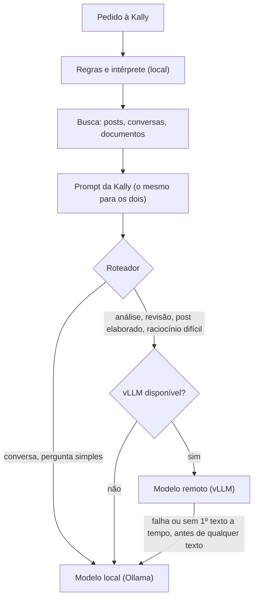

# Kally híbrida: modelo local + modelo remoto (vLLM)

Estado: implementada e testada com um vLLM falso e com um modelo real atrás da API OpenAI do
Ollama. **Ainda não foi testada com o Qwen 32B no Vast.ai** (a instância não estava configurada
quando o código foi escrito). Desligada por padrão: sem `KALLY_REMOTE_ENABLED="1"`, a Kally
funciona exatamente como antes.

## Arquitetura anterior

- Uma rota gera as respostas do app e do site: `src/app/api/mobile/env/[env]/kally/route.ts`.
- Pipeline (`KALLY_PIPELINE`): regras (`detectIntent`) e, quando elas não bastam, o intérprete
  (`src/server/kally/pipeline.ts`) classificam o pedido em competência (estudo, post, análise),
  modo e profundidade; o executor responde.
- Executor e intérprete: o mesmo modelo local (`KALLY_EXECUTOR_MODEL`, padrão
  `qwen3:4b-instruct-2507-q4_K_M`), pelo Ollama, com o gerenciador central de modelos
  (`src/server/ai/model-manager.ts`: um modelo de texto carregado por vez).
- RAG: busca de posts e conversas (`findRelevantPosts`) e de documentos (`searchDocuments`), com
  embeddings `qwen3-embedding:0.6b` na CPU. A busca é feita antes e fora da inferência; o prompt
  montado (`buildPrompt` / `buildCompetencePrompt`) já leva os trechos recuperados.
- Camada de IA: `src/server/ai.ts` (Ollama `/api/chat` ou, com `AI_PROVIDER=openai`, qualquer
  `/v1/chat/completions`, mas global, um provedor para tudo).

## Arquitetura nova

O que mudou, em ordem dos commits:

1. `think: false` para modelos híbridos (`KALLY_NO_THINK_MODELS`): o `qwen3:8b` raciocina por
   padrão e a 1ª palavra levava 30 a 52 s no pipeline.
2. `src/server/ai.ts`: cada chamada escolhe o destino (`target: "local" | "remote"`) e pode ser
   cancelada (`signal`). O caminho remoto reaproveita o modo OpenAI, sem o gerenciador de modelos
   (a GPU é outra), com métricas do bloco `usage`, o raciocínio `<think>` fora do texto e erro
   quando o stream termina sem `finish_reason`/`[DONE]` (conexão caída no meio não vira resposta
   "completa").
3. `src/server/ai/remote.ts`: configuração, saúde (`GET /v1/models`, confere se o modelo
   configurado é o servido e lê o `max_model_len`), estados, cache curto e vagas simultâneas.
4. `src/server/kally/router.ts`: decide local ou remoto com os sinais que a rota já tem. Nenhum
   modelo extra roda para decidir.
5. Rota da Kally: roteamento, fallback, cancelamento quando a pessoa sai, `backend` e motivo no log
   de desempenho (`logs/kally-perf.jsonl`), sem conteúdo do pedido.
6. `src/server/ai/gpu.ts` e `src/app/api/mobile/kally/gpu/route.ts`: GPU sob demanda no Vast.ai.

## Configuração (.env do servidor; nada disso vai para o app)

| Variável | Padrão | Para quê |
|---|---|---|
| `KALLY_EXECUTOR_MODEL` | `qwen3:4b-instruct-2507-q4_K_M` | modelo local (já existia; é o "KALLY_LOCAL_MODEL") |
| `KALLY_GPU_LAYERS` | — | camadas na placa por modelo; para o 8B IQ4_XS, `qwen3-8b-iq4xs=30` |
| `KALLY_NO_THINK_MODELS` | — | modelos que recebem `think: false` (ex.: `qwen3-8b-iq4xs,qwen3:8b`) |
| `KALLY_REMOTE_ENABLED` | desligado | `"1"` liga o modelo remoto |
| `KALLY_VLLM_BASE_URL` | — | endereço do vLLM (`http://IP:PORTA`, com ou sem `/v1`) |
| `KALLY_VLLM_API_KEY` | — | a chave do `--api-key` do vLLM |
| `KALLY_REMOTE_MODEL` | — | o id servido (`--served-model-name`) |
| `KALLY_REMOTE_TIMEOUT_MS` | 240000 | teto da resposta remota inteira |
| `KALLY_REMOTE_FIRST_TOKEN_MS` | 25000 | sem 1º texto nesse tempo, responde o local |
| `KALLY_REMOTE_MAX_CONCURRENCY` | 2 | respostas remotas ao mesmo tempo; acima disso, local |
| `KALLY_VAST_ENABLED` | desligado | `"1"` liga o controlador da GPU |
| `KALLY_VAST_API_KEY` / `KALLY_VAST_INSTANCE_ID` | — | chave e instância do Vast.ai |
| `KALLY_GPU_AUTOSTART` | desligado | `"1"`: um pedido que precisa do remoto liga a GPU (a resposta dele sai no local) |
| `KALLY_GPU_IDLE_MINUTES` | 20 | desliga o que o controlador ligou depois de N min sem uso remoto |
| `KALLY_GPU_MAX_USD_PER_DAY` | 5 | gasto máximo de GPU por dia (pelo `dph_total` do Vast.ai) |
| `KALLY_GPU_MAX_STARTS_PER_DAY` | 6 | tentativas de ligar por dia |
| `KALLY_GPU_BOOT_TIMEOUT_MIN` | 15 | ligando há mais que isso sem o vLLM responder: estado de erro |

Os nomes pedidos `KALLY_LOCAL_MODEL` e um segundo teto de tempo não foram criados para não duplicar
`KALLY_EXECUTOR_MODEL` e `KALLY_TIMEOUT_MS`, que já existiam.

## Roteamento

Fica no local: papo casual; pedido de resposta curta ("rapidinho"); post com pouca matéria ou que
ainda não é para escrever; conversa e perguntas comuns, inclusive as respondidas pela base
(a prova factual com RAG já dá 4,4 de 5 no 4B, rodada 2 da simulação).

Vai para o remoto: post elaborado (profundidade aprofundada, mensagem longa ou muito material);
revisão crítica de um texto (anexado, escolhido ou citado na mensagem); análise crítica; documento
ou anexo com mais de 6.000 caracteres; estudo aprofundado; pedidos com sinais do que o modelo local
erra nas rodadas (código e bugs, artigos de lei, roteiros com restrições de tempo ou páginas,
comparações elaboradas); síntese de 4 fontes ou mais em profundidade.

Escolha explícita: o corpo do pedido aceita `model: "auto" | "local" | "remote"`, só para o
administrador da plataforma e para quem é dono do ambiente (o remoto custa dinheiro). Nenhuma
mudança de interface foi necessária.

## Fallback e experiência

- Remoto fora do ar, inicializando, com outro modelo servido, chave recusada, sem vaga ou sem
  contexto para o pedido: responde o local, sem aviso técnico para a pessoa.
- Remoto que falha ou não manda o 1º texto em `KALLY_REMOTE_FIRST_TOKEN_MS`, antes de qualquer texto:
  o mesmo prompt vai para o local (a conversa não se perde, nada é misturado).
- Remoto que cai depois do 1º texto: a pessoa recebe o erro "A resposta foi interrompida antes do
  fim." (a parte recebida não é apresentada como completa). Não há troca no meio da resposta.
- Cancelamento: fechar a conversa encerra a geração (local ou remota) e libera o modelo.

## RAG

Nada na base mudou: os mesmos documentos, embeddings, conversas, metadados e permissões. A busca
continua antes e fora da inferência, e os dois modelos recebem o mesmo prompt, com os mesmos
trechos. O prompt é conferido contra o `max_model_len` do vLLM (estimativa de ~3,2 caracteres por
token): se não couber com folga para a resposta, o pedido fica no local. Testado: a pergunta
"qnd é o encontro de trocas?" pelo caminho remoto achou "toda quarta-feira, às 20h" no guia do
ambiente de teste.

## GPU sob demanda (Vast.ai)

API oficial (documentação do Vast.ai): `PUT /api/v0/instances/{id}/` com `{"state": "running"}`
ou `{"state": "stopped"}`; `GET` na mesma rota traz `actual_status` e `dph_total`. O controlador
**nunca destrói** instância nem volume.

- Parada: a GPU deixa de ser cobrada; o disco continua sendo, e os dados ficam.
- Ao religar, a instância pode esperar indefinidamente se a GPU foi alugada por outra pessoa
  (aviso da própria documentação): o controlador marca erro depois de `KALLY_GPU_BOOT_TIMEOUT_MIN`.
- A permissão `instance_write` que liga e desliga também permite destruir: guarde a chave só no
  `.env` do servidor.
- Travas: uma operação por vez, intervalo mínimo de 10 min entre tentativas de ligar, limite de
  tentativas e de gasto por dia, desligamento por inatividade (só do que o controlador ligou). O
  estado fica em `.cache/kally-gpu.json` (fora do Git) para sobreviver a reinícios.
- Rota do administrador da plataforma: `GET /api/mobile/kally/gpu` (estados e gasto, sem endereço
  nem chave) e `POST` com `{ "acao": "ligar" | "desligar" | "verificar" }`.
- Pendente de verificação real: depois de religar, o IP e a porta externa da instância podem mudar
  (a API não documenta o campo do mapeamento da porta 8000). Se mudarem, `KALLY_VLLM_BASE_URL`
  precisa ser atualizado.

## Testes executados (instância de teste isolada, banco próprio, porta 3002)

Roteamento e fallback (`kally-bench/ab/test_hibrido.py`, com um vLLM falso): 15 de 15, mais o caso
do remoto desligado. Papo casual no local; análise e revisão de texto citado no remoto; o remoto
recebe o prompt completo e pede `usage`; escolha explícita só para quem pode; `<think>` não chega à
pessoa; sem 1º texto em 5 s, responde o local; HTTP 500, responde o local; queda no meio, erro
explícito; outro modelo servido, não usa o remoto; cancelamento encerra a geração local; rota da GPU
fechada para quem não é administrador da plataforma.

Modelo real atrás da API OpenAI (o Ollama no papel do vLLM): 2 de 2, com streaming e RAG.

GPU (`kally-bench/ab/test_gpu.py`, contra um Vast.ai falso): 9 de 9, mais o caminho automático.
Lê o estado; não expõe endereço nem chave; liga com `state=running`; não liga de novo com ela
ligada; o vigia desliga por inatividade; bloqueia nova tentativa no intervalo mínimo; nenhum
`DELETE`; conta tentativas e gasto; com `KALLY_GPU_AUTOSTART`, um pedido liga a GPU uma vez e é
respondido no local sem esperar.

Limitação: o ESLint do projeto não roda (o typescript-eslint não suporta o TypeScript 7; já era
assim na main). A checagem de tipos (`tsc --noEmit`) passa.

## Como ligar

1. No Vast.ai: vLLM com `--api-key`, `--served-model-name`, `--max-model-len` e a porta exposta.
2. No `.env` do servidor: `KALLY_REMOTE_ENABLED`, `KALLY_VLLM_BASE_URL`, `KALLY_VLLM_API_KEY`,
   `KALLY_REMOTE_MODEL` (e, para a GPU sob demanda, as variáveis `KALLY_VAST_*`).
3. Conferir pela rota do administrador (`POST /api/mobile/kally/gpu` com `{"acao":"verificar"}`):
   o estado precisa ser `disponivel`, com o modelo e o `max_model_len` esperados.
4. Para desligar o remoto: `KALLY_REMOTE_ENABLED="0"` (nada mais muda). Para voltar todo o código,
   reverter os commits listados acima.
